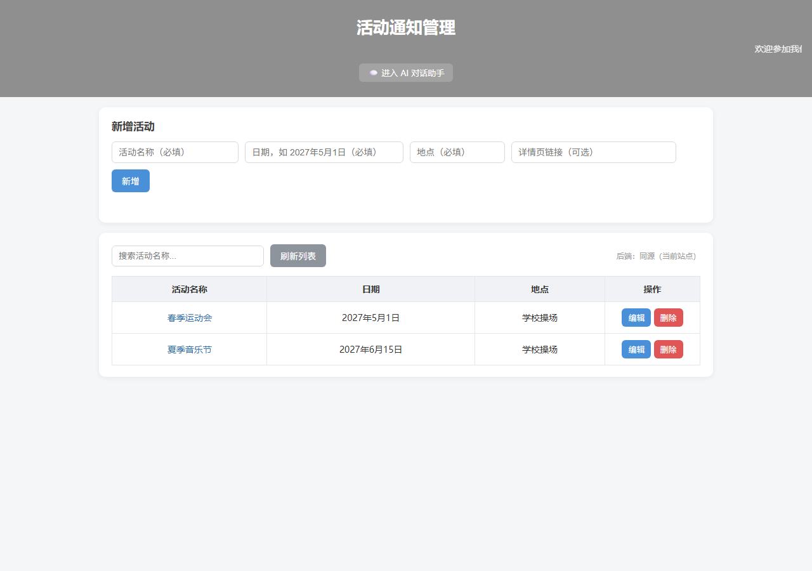
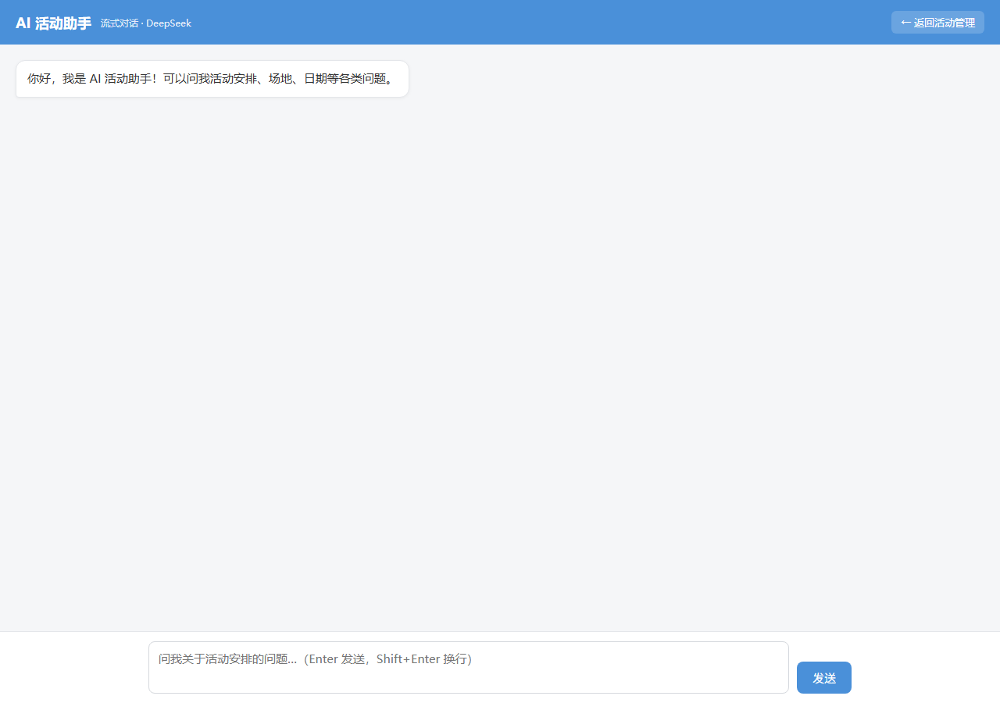
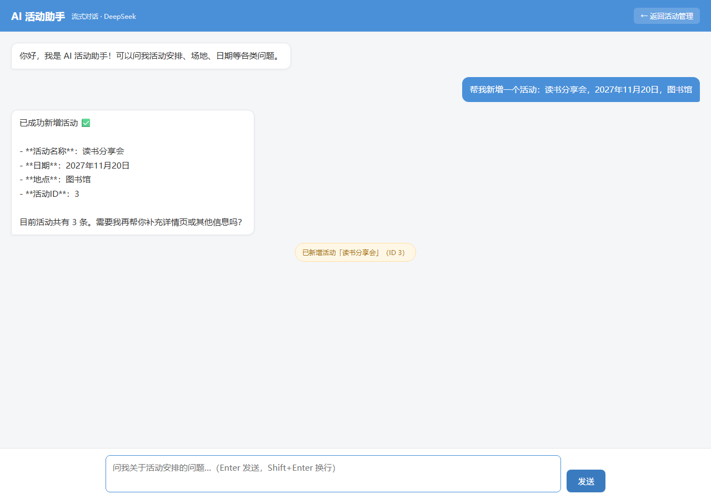

# 活动通知管理 · AI 智能助手

一个集「活动管理」与「AI 对话」于一体的单服务 Web 应用：**一个页面、一套接口、一个数据存储、一个 AI 能力，四者互相打通**。

- 用户可以通过网页界面（或 AI 对话）对活动进行**增、删、改、查**；
- 所有操作落盘到本地 `data.json`，重启不丢失；
- 内置 DeepSeek 大模型，AI 助手既能**读懂活动数据回答问题**，也能**调用工具真正新增 / 修改 / 删除活动**。

---

## 一、项目简介（解决什么问题）

很多活动通知类小工具只有「展示」，管理动作要人工改文件或写 SQL。本项目要解决的是：

1. **活动管理太麻烦** —— 提供网页表单 + 列表，点几下就能增删改查；
2. **数据不落地** —— 所有写入实时持久化到 `data.json`，刷新、重启都不丢；
3. **AI 只是摆设** —— 让 AI 不再是"只会聊天"的玩具，而是能**真正读写活动数据**的智能助理；
4. **Key 安全** —— 大模型 API Key 只放在服务端环境变量，绝不进前端代码。

---

## 二、技术栈

| 分类 | 技术 | 说明 |
|---|---|---|
| 后端 | Node.js（≥18）+ Express | 提供 REST 接口 + 静态托管 + SSE 流式转发 |
| 前端 | 原生 HTML / CSS / JavaScript | 无框架，`index.html`（管理页）、`chat.html`（对话页） |
| 数据 | JSON 文件（`data.json`） | 同步读写落盘，零依赖数据库 |
| AI | DeepSeek（deepseek-chat） | 兼容 OpenAI 格式，支持流式输出 + Function Calling |
| 部署 | Docker / Railway / Render | 根目录含 `Dockerfile` 与 `render.yaml` |

---

## 三、本地运行步骤

### 1. 安装依赖

```bash
npm install
```

### 2. 配置环境变量

复制 `.env.example` 为 `.env`，填入你的 DeepSeek API Key：

```bash
# Linux / macOS
cp .env.example .env

# Windows
copy .env.example .env
```

编辑 `.env`：

```dotenv
# DeepSeek 开放平台 API Key（必填）
# 获取地址：https://platform.deepseek.com → 左侧「API Keys」→ 创建
DEEPSEEK_API_KEY=sk-你的Key

# 以下均有默认值，一般无需修改
DEEPSEEK_BASE_URL=https://api.deepseek.com
DEEPSEEK_MODEL=deepseek-chat
CHAT_MAX_CONTEXT_CHARS=12000
CHAT_MAX_HISTORY_TURNS=20
CHAT_TIMEOUT_MS=60000
```

> ⚠️ `.env` 已被 `.gitignore` 忽略，不会提交到代码库。**不要把 Key 写进前端 JS。**

### 3. 启动服务

```bash
npm start
# 或
node app.js
```

看到 `活动通知接口已启动: http://localhost:3000` 即成功。

### 4. 打开页面

- 管理页：<http://localhost:3000/>
- AI 对话页：<http://localhost:3000/chat.html>

---

## 四、功能截图

### 活动管理页（增删改查）



### AI 对话页

**欢迎界面**：



**AI 查询活动**（数据注入，准确读出活动信息）：


**AI 新增活动**（工具调用，真正写入数据）：



---

## 五、接口一览

统一返回格式 `{ code, data, msg }`，`code = 0` 表示成功。

| 方法 | 路径 | 说明 |
|---|---|---|
| `GET` | `/api/activities` | 获取活动列表 |
| `POST` | `/api/activities` | 新增活动 |
| `PUT` | `/api/activities/:id` | 修改活动 |
| `DELETE` | `/api/activities/:id` | 删除活动 |
| `POST` | `/api/chat` | AI 对话（SSE 流式 + 工具调用） |

完整接口文档见 [API.md](API.md)。

---

## 六、AI 能力说明

`/api/chat` 接口实现两个核心能力：

1. **数据注入（读）**：每次对话前，后端读取 `data.json` 的活动列表注入系统提示词，AI 能准确回答「有哪些活动、在哪办」；
2. **工具调用（写）**：通过 DeepSeek Function Calling 定义三个工具，AI 决定调用后由后端真正执行增删改：
   - `add_activity` 新增活动
   - `update_activity` 修改活动
   - `delete_activity` 删除活动

流式输出逐字推送给前端；支持「停止生成」；多轮对话带上下文，超长自动丢弃最早消息。

---

## 七、目录结构

```
Web_manage/
├── app.js                 # 后端入口：REST 接口 + 静态托管 + AI 对话(SSE)
├── index.html             # 活动管理页（增删改查）
├── chat.html              # AI 流式对话页
├── config.js              # 前端 API 地址配置
├── data.json              # 数据存储（活动列表）
├── .env.example           # 环境变量模板
├── .env                   # 本地环境变量（已忽略，不提交）
├── package.json           # 依赖与脚本
├── Dockerfile             # Docker 镜像
├── render.yaml            # Render 部署蓝图
├── content/               # 活动详情页
├── images/                # 图片资源
├── screenshots/           # 功能截图
├── scripts/               # 截图 / 验证脚本
└── docs/                  # 问题记录文档
```

---

## 八、已知问题

1. **数据存储用 JSON 文件，非数据库**：`data.json` 适合小规模演示；并发写入或大量数据时建议换 SQLite / PostgreSQL（只需改写 `readData` / `writeData` 两个函数）。
2. **Railway / Render 免费版磁盘不持久**：重新部署或服务休眠后，`data.json` 会恢复成仓库初始数据；需长期保存要挂持久磁盘（Volume）。
3. **AI 无鉴权，公网开放会消耗 Key 额度**：`/api/chat` 目前任何人可调用；若长期上线，建议加访问令牌或用量限制。
4. **冷启动延迟**：免费托管平台无流量会休眠，首次访问需等待唤醒。
5. **AI 删除操作暂无二次确认**：系统提示词已要求 AI 删除前先确认目标，但缺少强制的程序级确认；如需更严格，可在工具执行前加拦截。

---

## 九、部署

- **Railway**：见 [RAILWAY_DEPLOY.md](RAILWAY_DEPLOY.md)
- **Render**：见 [DEPLOY.md](DEPLOY.md)
- 两种平台均支持 Docker 或原生 Node 部署，`DEEPSEEK_API_KEY` 在平台的环境变量（Variables）中配置。
