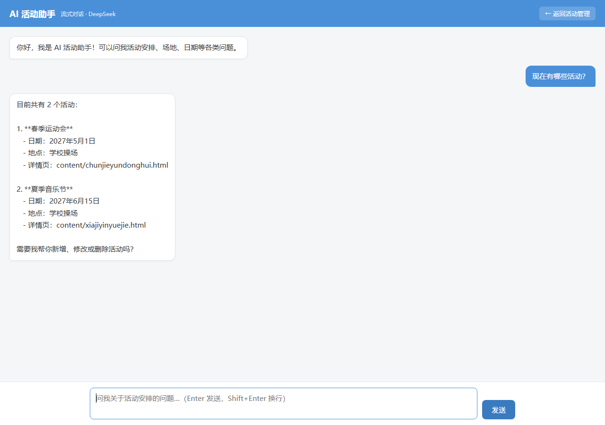

# 活动通知管理 · AI 智能助手

一个很简单的 Web 应用，把「活动管理」和「AI 对话」合在了一起。

你可以：
- 在网页上**增、删、改、查**活动；
- 跟网页里的 **AI 助手聊天**，它不仅能回答活动相关问题，还能帮你**真的新增 / 修改 / 删除活动**。

数据存在一个 `data.json` 文件里，关掉再打开也不会丢。

---

## 一、这个项目是干嘛的

很多活动通知小工具只能「看」，想改还得手动改文件。这个项目解决的是：

1. **管理活动太麻烦** → 用网页表单点几下就能增删改查；
2. **数据存不住** → 所有改动实时写进 `data.json`，刷新、重启都不丢；
3. **AI 只会聊天、不干实事** → 让 AI 真正能读写你的活动数据；
4. **API Key 泄露风险** → Key 只放在服务器端的环境变量里，绝不写进网页代码。

---

## 二、用了什么技术

| 分类 | 技术 | 一句话说明 |
|---|---|---|
| 后端 | Node.js + Express | 提供接口 + 托管网页 + 转发 AI |
| 前端 | 原生 HTML / CSS / JS | 没有框架，就两个网页文件 |
| 数据 | JSON 文件 | 简单，不用装数据库 |
| AI | DeepSeek | 会流式打字，还能调用工具 |
| 部署 | Docker / Railway / Render | 一键上线到公网 |

> 新手不用纠结这些，能跑起来就行。

---

## 三、本地运行（3 步）

### 第 1 步：安装依赖

在项目文件夹里打开终端，运行：

```bash
npm install
```

### 第 2 步：配置 API Key（AI 功能需要，管理功能不需要）

1. 把 `.env.example` 复制一份，改名为 `.env`：

   ```bash
   # Windows
   copy .env.example .env
   ```

2. 打开 `.env`，填上你的 DeepSeek Key：

   ```dotenv
   DEEPSEEK_API_KEY=sk-你的Key
   ```

   > Key 去哪拿？打开 <https://platform.deepseek.com> → 注册登录 → 左侧「API Keys」→ 创建，复制 `sk-` 开头的一串。

   > ⚠️ 其他几项（模型、超时等）都有默认值，**不用改**。

### 第 3 步：启动

```bash
npm start
```

看到 `活动通知接口已启动: http://localhost:3000` 就成功了。

然后打开浏览器访问：

- 活动管理页：<http://localhost:3000/>
- AI 对话页：<http://localhost:3000/chat.html>

> 注意：`.env` 已经被 `.gitignore` 忽略了，**不会**提交到 GitHub，你的 Key 是安全的。

---

## 四、功能截图

**活动管理页**（增删改查）：


**AI 对话页**——欢迎界面：


**AI 查询活动**（能准确读出活动数据）：



**AI 新增活动**（真的写进了数据）：


---

## 五、接口一览

所有接口返回格式都是 `{ code, data, msg }`，`code = 0` 表示成功。

| 方法 | 路径 | 作用 |
|---|---|---|
| `GET` | `/api/activities` | 获取活动列表 |
| `POST` | `/api/activities` | 新增活动 |
| `PUT` | `/api/activities/:id` | 修改活动 |
| `DELETE` | `/api/activities/:id` | 删除活动 |
| `POST` | `/api/chat` | AI 对话（流式 + 工具调用） |

---

## 六、AI 是怎么工作的

`/api/chat` 接口做了两件事，让 AI「能读又能写」：

1. **读（数据注入）**：每次对话前，后端先读一遍 `data.json`，把活动列表塞进给 AI 的提示词里。所以 AI 能准确回答「现在有哪些活动」。
2. **写（工具调用）**：告诉 DeepSeek 它有三个「工具」可以用，AI 判断你要增删改时，会调用对应的工具，由后端真正去改数据：
   - `add_activity` —— 新增活动
   - `update_activity` —— 修改活动
   - `delete_activity` —— 删除活动

另外还支持：回答一个字一个字地流出来、点「停止生成」、多轮连续对话。

---

## 七、目录结构

```
Web_manage/
├── app.js             # 后端（接口 + 托管网页 + AI 对话）
├── index.html         # 活动管理页
├── chat.html          # AI 对话页
├── config.js          # 前端接口地址配置（一般不用改）
├── data.json          # 数据存储（活动列表）
├── .env.example       # 环境变量模板（复制成 .env 用）
├── .env               # 你的 Key（本地文件，已忽略不提交）
├── package.json       # 项目依赖
├── Dockerfile         # Docker 镜像（部署用）
├── render.yaml        # Render 部署配置（部署用）
├── content/           # 活动详情页
├── images/            # 图片
└── screenshots/       # README 里的截图
```

---

## 八、已知问题（不影响学习使用）

1. **数据用的是 JSON 文件，不是数据库**：适合小项目演示；数据量大了建议换数据库（只需要改 `app.js` 里的 `readData` / `writeData` 两个函数）。
2. **免费平台磁盘不持久**：部署到 Railway / Render 免费版后，重新部署会重置 `data.json`；要长期保存得挂「持久磁盘（Volume）」。
3. **AI 接口没有鉴权**：公网开放后任何人都能调，会消耗你的 Key 额度；长期上线建议加个访问限制。
4. **冷启动慢**：免费平台没流量时会休眠，第一次打开要等几秒。

---

## 九、部署上线（让全世界都能访问）

有两种平台都支持，选一个即可。

### 方式 A：Railway（推荐）

1. 把代码推到 GitHub（`git push`）。
2. 打开 <https://railway.app>，用 GitHub 登录。
3. 点 **New Project → Deploy from GitHub repo**，选 `Web_manage` 仓库，它会自动识别 Dockerfile 构建。
4. 部署好后，进项目的 **Variables** 页，添加变量：
   - `DEEPSEEK_API_KEY` = 你的 Key
5. 到 **Settings → Networking → Generate Domain**，得到 `xxx.up.railway.app` 公网地址。

> 以后改了代码，`git push` 后如果没自动更新，就在 Railway 项目里按 **Ctrl+K → Deploy Latest Commit** 手动拉最新代码。

### 方式 B：Render

1. 打开 <https://render.com>，用 GitHub 登录。
2. **New → Web Service**，选 `Web_manage` 仓库（项目里已有 `render.yaml`，会读配置）。
3. 在 **Environment** 里添加 `DEEPSEEK_API_KEY`。
4. 部署完成后得到 `xxx.onrender.com` 地址。

---

**一句话总结**：本地跑 `npm start`，配好 Key，网页和 AI 都能用；想给别人用就部署到 Railway，配一个环境变量 `DEEPSEEK_API_KEY` 即可。
